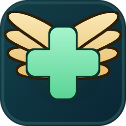

# Aion2Heal – AION 2 Healer Overlay

<p>
  
</p>

<p>
  <a href="https://github.com/rassau/AION2HealerOverlay/releases">
    
  </a>
  <a href="./LICENSE.txt">
    
  </a>
</p>

A real-time combat meter overlay for **AION 2**, with extra tools for healers: a group frame with fast HP bars, shields,
buffs, debuffs, distances and a boss-target alert, and healing, damage-taken and aggro columns in the meter.

It is a modified version of [**Aion2Flow**](https://github.com/cloris-chan/Aion2Flow) by cloris-chan and, like it,
licensed under the [GNU GPL v3](./LICENSE.txt). The meter itself and everything listed under "From Aion2Flow" below is
cloris-chan's work; this fork adds the healer features. It is not affiliated with or endorsed by the original project.

## What this fork adds

**Meter**

- Healing per second and total healing (with or without overhealing), damage taken, UHS (missing HP × seconds) and
  aggro columns, with column headings and a tooltip on every value.
- Every boss pull is its own fight: boss DPS, aggro (how long the boss targeted each player), a stagger gauge and an
  optional DPS check against a time limit.
- Exporting, importing and renaming history entries, opacity sliders, and a meter that folds away with a click on its
  title.

**Group frame** (Settings → Group frame)

- You and your party with HP bars that update faster than the game's party window, shields, debuffs, and the buffs and
  HoTs you cast.
- A direction arrow and the distance to each member, coloured by adjustable range marks.
- A red frame around whoever the boss is targeting, a warning when it's you, and an optional alert sound: a built-in
  chime or your own clip, cut from any sound or video file.
- Deaths per boss fight, and a side (left, right or off) and an opacity for each part of a row.

Every change is listed in the [changelog](./CHANGELOG.md).

## From Aion2Flow

- Live DPS and total-damage ranking with animated contribution bars.
- Configurable player scope: self, party, force, or everyone in the encounter.
- Standard and boss-only scene modes, with boss HP and damage-share displays when the required data is available.
- Combatant details with outgoing/incoming views, target/source filters, and per-skill damage, healing, shield, and
  shield-absorption breakdowns.
- In-session history of recent encounters, with archived result browsing and experimental timeline playback.
- Capture status and game round-trip latency shown directly on the overlay.
- Interactive, click-through, and hidden overlay modes, plus configurable global shortcuts for display mode and battle
  reset.
- Traditional Chinese, English, and Korean UI and game-data display.

## Requirements

- Windows x64.
- The current AION 2 client.
- Administrator approval when the overlay starts. This is required for its bundled WinDivert capture driver.

Releases need no separate .NET installation. Npcap and WinPcap are not required.

## Download

[**Download the latest portable ZIP**](https://github.com/rassau/AION2HealerOverlay/releases/latest/download/Aion2Heal-stable-Portable.zip)

Other release files and the version history are on [GitHub Releases](https://github.com/rassau/AION2HealerOverlay/releases).

## Getting Started

1. Download the portable ZIP and unpack it into a folder of its own.
2. Launch `Aion2Heal.exe` and accept the Windows administrator prompt. It starts the newest installed version, which is
   kept in the `current` folder.
3. Start AION 2. The overlay waits for `Aion2.exe`, detects the active game connection, and begins updating when combat
   data arrives.
4. If no data appears, check the three status indicators at the bottom of the overlay: capture driver, game port, and
   battle connection.

## Updates

At the bottom of the settings:

- **Update now** checks this project's GitHub Releases, downloads a newer version and restarts into it.
- **Update automatically** (off by default): when on, the overlay checks and downloads at every start and installs the
  update when you close it.

Your settings and alert sounds stay as they are.

## Using the Overlay

- Drag the title area to move the overlay; click the title to fold the meter away.
- Use the reset button or your configured global shortcut to end the current encounter and start a fresh one.
- Select a combatant to open detailed outgoing/incoming statistics and skill breakdowns.
- Open **Settings** (the meter's gear) for a window with a tab each for general settings, every frame's scale and
  opacity, sounds, the meter, the group frame, the skill monitor, the fight graphs, the digital twin library and the
  system (packet recording, updates). The gears of the group frame and the fight graphs open their own tab.
- Use the pin control or display-mode shortcut to cycle between interactive, click-through, and hidden modes.
- Open **History** to inspect, export or import an encounter. Its play button opens the experimental timeline playback.

Encounter history is kept in memory while the overlay runs; export an entry to keep it (a `.aion2heal` file; exports
from before the rename, `.aion2flow`, import too).

## Safety and Data

The overlay analyzes game network traffic locally.

- It does not modify game files.
- It does not inject into the game process.
- It does not read game memory.
- It only connects to this project's GitHub Releases, to look for updates: with **Update now**, or at start with
  **Update automatically** on.

## Build from Source

Building, testing, or publishing from source requires the .NET 10 SDK; publishing (a Native AOT Windows x64 build) also
needs the Visual Studio C++ build tools.

```powershell
dotnet build Aion2Flow.slnx -c Release
dotnet test --solution Aion2Flow.slnx -c Release --max-parallel-test-modules 1
dotnet publish src/Aion2Flow/Aion2Flow.csproj -c Release
```

The default publish output is:

```text
src/Aion2Flow/bin/Release/net10.0-windows/win-x64/publish/
```

## Current Limitations

- Playback and encounter history are available only for encounters captured during the current session, or imported
  from an export.
- If the overlay starts after the game, it may miss initial data and temporarily be unable to show some names, icons,
  boss HP values, or scene names. Return to character selection and re-enter the game, or teleport once, to refresh that
  data.
- A game update can change combat data and temporarily affect statistics. Install the latest release after major client
  updates.

This project is not affiliated with, endorsed by, or sponsored by NCSOFT or any AION 2 publisher.

## Thanks

Aion2Flow by cloris-chan is the foundation of this overlay. If you'd like to support its author, see the
[Aion2Flow page](https://github.com/cloris-chan/Aion2Flow).

WinDivert by Basil captures the game traffic; see [third-party notices](./THIRD-PARTY-NOTICES.md).
